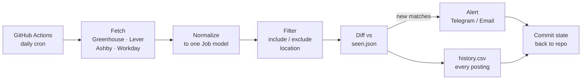

# Job Watcher

**Status: live since 8 Nov 2026.** Runs daily at 08:47 IST and watches 7 consulting and advisory firms (ZS, Kearney, L.E.K., BearingPoint, FTI, Marsh McLennan incl. Oliver Wyman, BCG). Portfolio facts and charts are in [`portfolio/`](portfolio/).

A scheduled pipeline that checks company job portals every morning, filters openings against role, seniority and location rules, and sends an alert only for postings it hasn't seen before. It runs free on GitHub Actions, with no server or database. Every posting it observes is logged, so over time it also builds a dataset of hiring activity per company.



## Design decisions

| Problem | Decision | Why |
|---|---|---|
| Every portal has a different format | One adapter per applicant-tracking system, all returning the same `Job` object | Adding a portal type means adding one file; filtering and alerting never change |
| Careers pages are JavaScript-rendered | Call each system's underlying JSON endpoint instead of scraping HTML | Faster, far less brittle, no headless browser needed |
| Same job alerted every day | `seen.json` stores job IDs; only unseen jobs are processed | Alerts mean "new", not "still open" |
| First run would look like 50 "new" jobs | First run per company is tagged as a baseline in the alert | You see current openings once, clearly labeled |
| One broken portal | Each source runs in its own try/except; failures are listed in the alert | One bad config line can't silence the other 14 companies |
| Alert fails to send | State is not saved if delivery fails | Nothing is marked "seen" that you were never told about |
| No database | State lives in two files committed back to the repo | Zero infrastructure, full audit trail in git history |

## Setup (about 20 minutes)

### 1. Create the repo
Create a new GitHub repository and push this folder to it.

GitHub Actions minutes are free and unlimited on public repos. On private repos the free monthly allowance covers a daily run of about a minute many times over.

### 2. Add your companies
Edit `config.yaml`. For each company, open its careers page, click into any job and look at the URL:

| URL looks like | source | config field |
|---|---|---|
| `boards.greenhouse.io/acme` or `job-boards.greenhouse.io/acme` | `greenhouse` | `board: acme` |
| `jobs.lever.co/acme` | `lever` | `board: acme` |
| `jobs.ashbyhq.com/acme` | `ashby` | `board: acme` |
| `acme.wd5.myworkdayjobs.com/en-US/Careers` | `workday` | `url:` the full careers URL (filter query params are sent as Workday facets) |
| iCIMS Jibe site, e.g. `jobs.zs.com` | `jibe` | `url:` site root |
| `<tenant>.recsolu.com/job_boards/...` (Yello) | `yello` | `url:` board URL with the long board id |
| Talemetry/Jobvite site with `/search/jobs` | `talemetry` | `url:` site root, optional `params:` |
| `<tenant>.tal.net/...` (Oleeo) | `oleeo` | `url:` the job board listing page |
| BearingPoint open-roles page | `bearingpoint` | `url:` the page with `?country=` |
| Phenom site, e.g. `careers.bcg.com/global/en` | `phenom` | `url:` up to the locale, `facets:` for server-side filters |

If a company's page matches none of these, it uses a custom or less common system. That portal needs its own adapter in `job_watcher/sources/`. Write one modeled on the existing files: each is about 50 lines.

**Portals that can't be watched:** some career pages load jobs from private, token-authenticated or bot-protected APIs (Grant Thornton Bharat, McKinsey and Bain are examples). Don't try to break into those. Use the portal's own alert, or a LinkedIn/Naukri alert for that company.

Remove the example entries, or set them to `enabled: false`.

### 3. Test locally
```bash
pip install -r requirements.txt
python -m job_watcher.main --dry-run
```
Each company should print a non-zero `listed` count. Zero usually means a wrong board name.

### 4. Set up alerts

**GitHub Issues (on by default, zero setup).** Each day with new matches the workflow opens an issue in this repo titled like `3 new role(s) · 2026-11-09` and @mentions you. GitHub emails it to you and pushes it to the GitHub mobile app. Close the issue once you've reviewed it. Check github.com/settings/notifications if emails don't arrive.

The channels below are optional extras.

**Telegram (recommended: instant phone push)**
1. In Telegram, message `@BotFather`, send `/newbot`, and copy the token.
2. Send any message to your new bot.
3. Open `https://api.telegram.org/bot<TOKEN>/getUpdates` in a browser and copy `chat.id`.

**Email via Gmail**
1. Turn on 2-Step Verification on your Google account.
2. Create an App Password (Google Account → Security → App passwords).

Add the values in GitHub under **Settings → Secrets and variables → Actions → New repository secret**:

| Secret | Value |
|---|---|
| `TELEGRAM_BOT_TOKEN` | bot token |
| `TELEGRAM_CHAT_ID` | your chat id |
| `SMTP_USER` | your Gmail address |
| `SMTP_PASSWORD` | the App Password |
| `ALERT_EMAIL_TO` | optional, defaults to `SMTP_USER` |

### 5. Run it
Go to **Actions → Daily job check → Run workflow** for the first run. After that it runs every day at 08:47 IST. To change the time, edit the cron line in `.github/workflows/daily.yml` (it's in UTC).

## Things to know
- **Scheduled runs can lag** by several minutes to an hour when GitHub is busy. That's fine for a daily check.
- **GitHub disables schedules on public repos after 60 days without activity.** If alerts go quiet for weeks, check the Actions tab and re-enable the workflow.
- **Be a polite client.** The script makes one request per board per day (a few for large Workday boards) and identifies itself in its User-Agent. Don't crank the schedule to every few minutes.
- **A public repo makes `config.yaml` public**, which reveals which firms you're targeting. Decide if you care.
- **Some sites block cloud servers.** A source that works on your laptop but returns 403 from GitHub Actions is being blocked by bot protection (L.E.K.'s board sits behind Cloudflare, for example). The run keeps going and lists it under "Sources that failed today". If it keeps failing, disable it and use that site's own alert.

## Data: `data/history.csv`
Every posting seen for the first time is appended with `first_seen`, company, title, location, URL and whether it matched your filters. After a few months this answers questions like:
- Which target firms are actually hiring junior roles, and in which months?
- How long do postings stay up?
- Which titles do firms use for the same entry-level role?

## Project layout
```
job_watcher/
  main.py          orchestration: fetch → filter → diff → alert → persist
  models.py        the shared Job model
  filters.py       whole-word keyword and location matching
  state.py         seen.json + history.csv
  notify.py        Telegram + email digests
  sources/         one adapter per portal type
tests/             offline tests with fake HTTP responses (pytest)
.github/workflows/ daily.yml (the schedule), tests.yml (CI)
```

## Tests
```bash
pip install pytest
pytest -q
```
The suite covers every adapter (including Workday pagination), filter edge cases ("Sr." vs "Senior", "Associate" vs "Associated"), the first-run → diff → no-change cycle, partial and total source failure, alert-failure rollback, message chunking, HTML escaping and secret redaction.
